# Rights Graph — data schema for the database and backend

The schema the backend builds on: what each table holds, why it is shaped that way, which rule
it enforces, and which surface or API call it serves. The runnable DDL is
[`db/schema.sql`](../db/schema.sql) (PostgreSQL 16); [`db/test.mjs`](../db/test.mjs) loads it and
proves the rules below against the data-model doc's worked example.

```bash
npm run db:test        # loads db/schema.sql into PGlite (Postgres in WebAssembly — no server needed)
```

Sources: *Rights Graph — Centralized Reframe & Data Model* (ERD, resolution rules, invariants,
write path, Proof Log, read models) and *Rights Graph Surfaces — FRD* (S1–S9), plus what the
prototype in this repository had to hold to work end to end — requests, notifications,
escalation, tenancy, ingestion and the S9 API — which the doc's ERD does not cover.

---

## 1. Principles the schema keeps

1. **Assertions first.** Every source's claim is its own row. The resolved view is derived into
   read models; nothing writes "the owner".
2. **Four kinds of fact, four tables.** Rights assertions (who owns, controls, administers,
   collects), clearance grants (what uses are permitted), attestations (signed statements),
   provenance records (how it was made). They never share a table.
3. **Append-only.** Assertions, grants and attestations are never updated in place and never
   deleted. A correction is a new row that `supersedes` the old one and closes its system time.
4. **Bitemporal.** `valid_period` (daterange — who owned it on a date) and `tx_period`
   (tstzrange — what we believed then) on every edge. Every read takes both.
5. **Composition and recording stay apart.** `side` is master or composition on every edge; a
   master grant never implies a composition grant.
6. **Territory and time on every edge.** A normalized `territory_set`, and a `valid_period` that
   must have a start.
7. **Who decided, on whose behalf, under what authority** is a column set on every grant,
   attestation, request decision and conflict resolution.
8. **Public means verifiable, not exposed.** The Proof Log carries event type, opaque ids, scope,
   use, time and hashes — never an amount, an attribution percentage or a person.
9. **Contributor segregation in the database**, not only in the app: row-level security by
   tenant, and private terms envelope-encrypted with the contributor's key.

## 2. Shape

Six schemas, 74 tables. One job each:

| Schema | Tables | Holds | Served to |
| ------ | -----: | ----- | --------- |
| `graph` | 40 | Assets, parties, agreements, the four fact kinds, links, conflicts, registrations, rule versions and the resolver's read models | Every surface; the resolver; the royalty engine |
| `workflow` | 6 | Requests (the approval inbox), escalation, notifications and their deliveries | S1–S4 inboxes, S3, S7 |
| `tenancy` | 10 | Organisations, people, roles, delegates, identity checks, profile claims, sharing policy, audit windows, access log | Every product's sign-in; S3 sign-up; S5 sharing and access; S7 tenant admin |
| `ingest` | 6 | Feeds, batches, row errors, saved field mappings, match results, coverage snapshots | S5, S7 ingestion and coverage |
| `api` | 8 | Keys and scopes, idempotency, the command log and outbox, webhooks, usage reports | S6, S9 |
| `proof` | 4 | Hash-chained signed events, Merkle batches, signing keys, receipts | S8, S6 receipts; external auditors |

`proof` runs as **its own service with its own database account and keys** in production — no
one at Sureel, Revelator or WMG can write it except through the outbox. It is in the same file so
the whole model reads in one place.

### Core relationships

```mermaid
erDiagram
  ASSET ||--o| WORK : is
  ASSET ||--o| RECORDING : is
  ASSET ||--o| VIDEO : is
  ASSET ||--o| RELEASE : is
  ASSET ||--o{ ASSET_IDENTIFIER : has
  PARTY ||--o{ PARTY_IDENTIFIER : has
  RECORDING ||--o{ RECORDING_WORK : embodies
  WORK ||--o{ RECORDING_WORK : "embodied in"
  VIDEO ||--o{ VIDEO_RECORDING : contains
  VIDEO ||--o{ VIDEO_WORK : "uses directly"
  RELEASE ||--o{ RELEASE_ITEM : contains
  ASSET ||--o{ CONTRIBUTION : credits
  ASSET ||--o{ RIGHTS_ASSERTION : on
  PARTY ||--o{ RIGHTS_ASSERTION : about
  SOURCE ||--o{ RIGHTS_ASSERTION : asserts
  AGREEMENT ||--o{ RIGHTS_ASSERTION : justifies
  TERRITORY_SET ||--o{ RIGHTS_ASSERTION : scopes
  RIGHTS_ASSERTION ||--o{ RESOLVED_EDGE : "wins into"
  PARTY ||--o{ CLEARANCE_GRANT : grants
  CLEARANCE_GRANT ||--o{ GRANT_PARTNER : "allow/deny list"
  PARTY ||--o{ ATTESTATION : signs
  CLEARANCE_GRANT ||--o{ GRANT_ATTESTATION : "satisfied by"
  ASSET ||--o{ PROVENANCE_RECORD : describes
  ASSET ||--o{ CONFLICT : "disputed on"
  CONFLICT ||--o{ CONFLICT_CLAIM : between
  WORKFLOW_REQUEST ||--o{ ESCALATION : "goes up"
  PERSON ||--o{ NOTIFICATION : told
  ORGANISATION ||--o{ MEMBERSHIP : employs
  PERSON ||--o{ MEMBERSHIP : holds
  ORGANISATION ||--o{ BATCH : uploads
  BATCH ||--o{ ROW_ERROR : fails
  BATCH ||--o{ MATCH_RESULT : matches
  API_KEY ||--o{ COMMAND_EVENT : writes
  COMMAND_EVENT ||--o{ OUTBOX : "queued to"
  PROOF_BATCH ||--o{ PROOF_EVENT : seals
  PROOF_EVENT ||--o| RECEIPT : "issued as"
```



---

## 3. `graph` — the facts

### Assets and parties

| Table | What it is | Key columns · rules |
| ----- | ---------- | ------------------- |
| `asset` | The supertype every fact points at, so a work, recording, video or release is addressed the same way and foreign keys hold | `kind`, `title`, `display_artist`, `label_party_id` (whose catalogue), `tenant_id` |
| `work` · `recording` · `video` · `release` | One row per asset of that kind; `(asset_id, kind)` is a foreign key so the kind can't disagree | recording: `released_on`, `first_delivered_at` (DSP delivery → tier T2); a **release holds no rights** (a trigger refuses an assertion on one) |
| `asset_identifier` | ISRC, ISWC, UPC/EAN, GRid, society work numbers, `ow_uri` (on-chain registry), proprietary ids | `valid` — an identifier that fails its check digit is **stored as invalid, never linked**; one valid ISRC/ISWC/UPC per value |
| `party` | Anyone with a place in the graph — labels, publishers, artists, writers, societies, AI platforms, DSPs, contributors, Sureel | `kind`, `society_id` (affiliation), `assurance` (ArtistID level), `tenant_id` |
| `party_identifier` | IPI, ISNI, ArtistID, DPID, society member numbers | `valid` as above |
| `territory_set` · `territory_member` | A normalized include/exclude set ("World excl. US, CA") and its expansion one country per row | canonical on write; `UNIQUE (world, includes, excludes)`; joins answer "in DE?" through `territory_member` |

### Links — only direct links are stored

| Table | From → to | Why |
| ----- | --------- | --- |
| `recording_work` | Recording → Work (`portion`, `method`, `confidence`, who linked, who confirmed) | Routes publishing income; a missing link is unmatched money. Bitemporal, so an unlink is a closed row |
| `video_recording` | Video → Recording (timecodes, usage) | A video inherits master rights and clearance from what it contains |
| `video_work` | Video → Work | A composition used with no label master (a cover, a live take) |
| `release_item` | Release → Recording/Video (disc, track) | Packaging and UPC delivery only |
| `derivation` | Asset → parent Asset (`sample`, `remix`, `cover`, `ai_derived`…) | Lineage; routes a share back to the parent's holders |
| `contribution` | Party → Asset (role, credited name, `credit_state`) | Credits — the subject of role attestations (S3 "confirm credit") |
| `same_as` | Party ↔ Party, Asset ↔ Asset (`method`, `confidence`, `state`, reviewer) | **Reversible dedupe, never a destructive merge** (S7-3, S7-4) |

The works a video touches are resolved at read time — its `video_work` rows plus the works its
recordings embody — so correcting one recording's link flows into every video automatically.

### Sources and agreements

| Table | What it is | Key columns · rules |
| ----- | ---------- | ------------------- |
| `source` | Where a claim came from | `kind` is its **precedence** (signed agreement → society ack → CWR submitted → label declaration → self-declared → platform claim); `lane`, `feed_id`, `batch_id`; `permitted_use` — a licensed source's limits, applied on read |
| `agreement` | The instrument that justifies an edge | `code` ('AGR-101'), `kind`, `valid_period`, `deal_basis`, territory; **`terms_ciphertext` + `terms_key_ref`** — private terms envelope-encrypted with the contributor's KMS key |
| `agreement_party` | Who signed, in what role | |
| `agreement_clause` | Clauses that give AUTHORITY | `grants_authority` e.g. `{attest_voice_nil_on_behalf}` (AGR-310 §7.4) — cited by grants and attestations |

### Rights assertions — the ownership layer (`rights_assertion`)

| Column | Meaning |
| ------ | ------- |
| `asset_id`, `party_id`, `side` | Work, recording or video (never a release); who the claim is about; master or composition |
| `interest` | owns · controls · administers · collects — **one row per interest**, four separate edges |
| `right_type` | RAD taxonomy v1 — **one row per right**; ingestion expands "all composition" into its rights |
| `share_type`, `share_pct` | writer · publisher · master · performer · producer; numeric(9,6), 0–100 — ownership, not payout |
| `share_of_assertion_id` | A share held of another claim's share ("Rhein Edition collects 50% of Harbor's 50%") |
| `territory_set_id`, `valid_period` | Required; the period must have a start |
| `tx_period` | When we believed it; open while it stands |
| `deal_basis`, `agreement_id`, `source_id` | at source / receipts; the instrument; where it came from |
| `supersedes_id`, `state`, `withdrawn_at/by` | The correction chain; resolved · contested · no_authority · superseded · withdrawn |
| `tenant_id` | The contributor tenant whose claim it is (row-level security) |

Enforced by the database:

- **Append-only**: a trigger refuses any change to an assertion's facts; only closing its
  `tx_period`, its `state` and its withdrawal can be written; a delete is ignored.
- **One claim per edge per source**: an exclusion constraint (`btree_gist`) refuses the same
  source asserting the same (asset, party, interest, right, share type, territory) for
  overlapping valid *and* system time — a correction must close the old row first.
- **Every OWNS / CONTROLS edge traces to an agreement or a declared source** (check).
- Share 0–100, territory and start date not null (checks).

### Clearance grants — the consent layer (`clearance_grant`, `grant_partner`, `use_dependency`)

| Column | Meaning |
| ------ | ------- |
| `scope_level`, `scope_ref` | artist · asset · release · label · catalogue — stored **at the scope it was made**, resolved at read time, never fanned out to every track |
| `copyright_side` | master · composition · both |
| `use_type`, `effect` | stream · download · ugc · sync · ai_training · ai_gen_derivative · ai_voice_nil · ai_streaming; grant or deny |
| `partner_scope` + `grant_partner` | all approved · allowlist · denylist, and the partners on it |
| `territory_set_id`, `valid_period`, `tx_period` | as for assertions |
| `granted_by_party_id`, `authority_assertion_id`, `authority_agreement_id`, `authority_clause` | **The authority a grant stands on.** None → `unauthorized = true`: stored, flagged, never auto-clears |
| `conditions` (jsonb) | `attestation_required`, licence model, thresholds |
| `state` | live · paused (held by a dispute) · revoked |
| `decided_by`, `decided_on_behalf_of`, `decided_at`, `request_id` | G-5 — who, for whom, when, answering which request |

Rules: an artist-level grant is Voice/NIL only (check). `use_dependency` holds the AI chain —
training is a prerequisite of derivative, Voice/NIL and AI streaming; the resolver revokes
dependents when training is revoked.

### Attestations — the evidence layer (`attestation`, `grant_attestation`)

`attestor_party_id`, `on_behalf_of_party_id` (a label for its artist), `subject_type` + `subject_id`
(asset · credit · grant · artist · provenance), `claim_type` (role confirmed/denied, human
performed, Voice/NIL consent, AI disclosure, AI opt-out, identity confirmed),
`identity_assurance` at signing, `payload` (the W3C VC shape, RFC 8785 canonical), `signature`
(JWS) + `key_id`, `issued_at`, `expires_at`, `revoked_at`, `disputed_at`, `state`.

Rules: an attestation **signed on someone's behalf needs the agreement that gives the authority**
(check) — without it, it stays `requested`, waiting on that person's own signature. A signed
attestation has a signature and an issue time. Revocation is a new event; the original stays.
`grant_attestation` records which attestations satisfy a grant's "attestation required".

### Provenance (`provenance_record`)

Several per asset — label-declared and platform-reported — cross-referenced, never merged:
`creation_class` (human · ai_assisted · ai_generated), `model_id`, `model_version_hash`,
`operator_party_id`, `training_data_fingerprint` (null = undisclosed, deliberately), `prompt_hash`,
`seed_hash`, `reported_by_party_id`, `inputs` (each input asset with its use and clearance receipt).

### Conflicts, evidence, registrations

| Table | What it is | Rules |
| ----- | ---------- | ----- |
| `conflict` | A disagreement the resolver would not pick a side on: overclaim · gap · missing work link · territory overlap · expired but paying · attestation dispute · unauthorized grant | `severity`, `revenue_at_risk` + currency, `total_share`, `state`, **`step` 0–3** (the counterclaim tracker), `interim` (what keeps paying), `assignee`; **a resolved conflict says why** — resolver, reason and rule version (check) |
| `conflict_claim` · `conflict_party` | The claims and parties in it | |
| `conflict_territory` | Accepting the resolved state **territory by territory** (S2-7) | one row per country, `accepted_at/by` |
| `conflict_comment` | Ops' discussion | |
| `evidence` | A file filed with a claim or a conflict response | digest (`sha256`), size, type, WORM `storage_url`, `approved_at` (counterclaim step 2) |
| `registration` | A work's registration with one society (S2-4) | missing · sent (in which CWR file) · acknowledged (society work number) · rejected (reason) |

### Resolution and read models

| Table / view | What it is | Consumer |
| ------------ | ---------- | -------- |
| `rule_version` | Versioned, replayable resolution rules: precedence order, change, state (draft · published · retired), replay results (values changed, revenue affected) | S7-7 |
| `graph_version` | A pinned snapshot: rule version + the system time it resolved at | Royalty runs pin one |
| `resolved_edge` | The resolved splits: one row per winning edge with `winning_assertion_ids` | Royalty engine, splits API |
| `effective_clearance` | The answer per (asset, use, partner, country, period): `answer`, `reason_code`, master and per-publisher composition answers, the deciding level and grants | Clearance API (P95 < 400 ms, 500 req/s) |
| `asset_revenue` | Net revenue per asset, period, country from the royalty engine | Revenue at risk, coverage weighting |
| `assertions_as_of(asset, as_of, known_at)` | The claims valid on a date as believed at a time | Bitemporal views (S1-12), restatements |
| `v_share_totals` | Ownership totals per (asset, right, share type, country) with reading `overclaim` / `gap` / `whole`; one party's own claims never add up | Overclaim and gap scans |
| `v_unlinked_earning_recordings` | Earning recordings with no work link, last 90 days | Nightly HIGH scan; S2-3 |
| `scope_chain(recording, artists)` | The scope chain a clearance read walks, most specific first | Resolver |

---

## 4. `workflow` — what needs a person

| Table | What it is | Key columns · rules |
| ----- | ---------- | ------------------- |
| `request` | One item in someone's inbox (S4): licence · attestation · conflict response · credit confirmation · delegate approval · profile claim | `from_party_id`, **`to_party_id` (whose inbox)**, use, side, scope, territory, period, **`deadline`**, `state` (needs decision · auto-cleared · approved · declined · countered · escalated · responded), `purpose`, `licence_model`, **`parent_request_id`** (one partner ask fanned out to each side's holder — F2), `cleared_by_grant_id`, `about_type/about_id`, the decision (`decided_by`, `on_behalf_of`, `authority`, `at`), `counter_terms`; a decided request has a decision time |
| `escalation_policy` | Per organisation: how long an item waits, and the chain of roles it goes up | e.g. 7 days; `{label_admin, revelator_support}` |
| `escalation` | One step up | `level`, from role, to role and person, `at`; one per level |
| `notification_pref` | A person's channels and digest | email, push (artist app), digest off/daily/weekly, quiet hours, timezone |
| `notification` | One notice to one person, about one record | `kind`, `about_type/about_id`, title, body, `read_at` |
| `notification_delivery` | Each channel's send | `state` queued · sent · failed · suppressed, `scheduled_at` (later in quiet hours or a digest), `sent_at`, provider ref |

---

## 5. `tenancy` — who signs in, and who may read what

| Table | What it is | Key columns · rules |
| ----- | ---------- | ------------------- |
| `organisation` | A party that signs in — label, publisher, contributor tenant, partner, Sureel. One company can be several | `is_contributor_tenant`, `white_label` |
| `person` | A human, with their ArtistID where they have one | `party_id` (their own graph entry), email or phone (one required), `assurance`, `signing_key_id` |
| `membership` | **Roles attach to an organisation and a context, not to a login** | (person, organisation, role) — label member/admin, publisher member/admin, artist, writer, delegate, contributor admin, partner, rights ops, data engineer, Revelator support |
| `delegation` | A manager or lawyer acting for an artist (S3-8) | invited email, **`scope`**, accepted/revoked; a delegate never signs up *as* the artist |
| `identity_check` | An ID check's outcome (S3-1) | document type, outcome passed/retake/failed, vendor case ref — **images stay with the vendor** |
| `profile_claim` | A person claiming an existing graph entry as theirs (S3-2) | entry, confirmer (label or Sureel), the request in the confirmer's inbox, evidence, state |
| `sharing_policy` · `sharing_policy_log` | Per contributor, per field: shared · private · encrypted (S5-5), and every change | |
| `audit_window` | A logged, **time-boxed (≤ 24 h)** window in which operators may read a contributor's private fields | reason, fields, period (check) |
| `access_log` | Every read of a contributor's data (S5-6) | reader, via (API key, console, job), what, the audit window it was under |

---

## 6. `ingest` — data coming in

| Table | What it is | Key columns · rules |
| ----- | ---------- | ------------------- |
| `feed` | A source feeding the graph | lane (owned · free · borrowed · bought · revelator), channel, cadence, error budget, last received, next due → **late / failing** on the console's home (S7-1) |
| `batch` | One upload or delivery | tenant, format (DDEX ERN/MWN, CWR, CSV, Parquet, JSON), channel, digest, `state` (received · validating · row errors · ingesting · matched · rejected), the four stage counts, mapping applied, `resubmits_batch_id` (a corrected file) |
| `row_error` | Row-level errors from the schema check — **nothing is ingested until they are fixed or dropped** (S5-1) | row, field, value, problem, `dropped` |
| `field_mapping` | A saved mapping reused on the next file (S5-9) | `headers_signature` recognises the next file; `rules` jsonb |
| `match_result` | What matching made of each row: matched · new · conflicting · unmatched · suggested (S5-3) | the asset/party it matched, the conflict it opened |
| `coverage_snapshot` | The four coverage measures, revenue-weighted, per lane, per month, per tenant — the 30 Nov gate number | master resolved · join rate · composition resolved · conflict rate |

---

## 7. `api` — S9

| Table | What it is | Key columns · rules |
| ----- | ---------- | ------------------- |
| `key` | An API key | public `key_id` prefix, **`secret_hash` (the secret is shown once)**, holder party, environment, `scopes`, audience (partner · holder · operator), `rotated_from`, `expires_at`, `revoked_at` |
| `idempotency` | The first answer to (key, Idempotency-Key) | same body replays it; a different body is a 409 |
| `command_event` | The write path's event store — every typed command (AssertRights, GrantClearance, RecordAttestation, RecordProvenance, LinkRecordingWork, Supersede) **in the same transaction as its projection rows** | unguessable `event_id`, key or person, payload, per-item outcome |
| `outbox` | Enqueued in that transaction; drained to the Proof Log, webhooks and the resolver | `destination`, delivered, attempts |
| `webhook_endpoint` · `webhook_delivery` | Partners' endpoints and each delivery | HTTPS only, signing secret hash; a revoke must reach subscribers **within 60 s** |
| `usage_report` · `usage_row` | What a partner used, when, for which outputs (S6-5) | ISRC, the asset it matched (null = flagged), use, the receipt it was cleared under |

Authorization rules the API enforces against these tables (the prototype's `scripts/api-check.ts`
proves them): a key writes only its **holder's** own claims; an attestation about someone else's
subject is signed only **on their behalf under an agreement**; only a party holding a recording or
its work may **link** them; a write's confirmation is read only by **the key that wrote it**.

## 8. `proof` — the Proof Log

| Table | What it is | Key columns · rules |
| ----- | ---------- | ------------------- |
| `event` | One proof event | `seq`, `event_type`, **`subject_opaque`** (never a real id), scope, use, `payload_hash` (SHA-256 of RFC 8785 JSON), **`prev_hash` → `event_hash`** (the chain; `prev_hash` unique), `signature` + `signer_key_id`, `batch_id`, WORM `payload_url`; imported on-chain events keep `chain_tx`, `chain_block`, `ow_asset_uri`. **No update, no delete** (rules) |
| `batch` | A Merkle batch every 5 minutes | `merkle_root`, sequence range, `sealed_at`, **`tsa_token`** (RFC 3161), `published_url` (transparency page; a public chain later) |
| `signing_key` | Ed25519 public keys, rotated and never withdrawn | private halves in the HSM |
| `receipt` | A signed clearance answer a partner keeps (S6-6) | verifies in S8 with the public key and the TSA token — no account, no amounts |

---

## 9. Invariants — where each is enforced

| Invariant (data-model doc) | Enforced by | On violation |
| -------------------------- | ----------- | ------------ |
| Shares per (asset, right, share type, territory, period) ≤ 100% | `v_share_totals` read by the resolver on every write | Conflict `overclaim`, HIGH if the asset earns |
| Shares < 100% | Nightly scan over `v_share_totals` | Conflict `gap`, with revenue at risk |
| Every edge has territory + valid_from | `NOT NULL` + check on `rights_assertion` | Write rejected |
| Every OWNS / CONTROLS edge traces to an agreement or a declared source | Check `owns_controls_trace` + FK to `source` | Write rejected |
| Every earning recording has ≥ 1 work link | `v_unlinked_earning_recordings`, nightly | Conflict `missing_work_link`, HIGH |
| Identifier formats valid (ISRC, ISWC, IPI, UPC check digits) | Ingestion validator; `asset_identifier.valid` | Stored as invalid, not linked |
| No destructive merge | `same_as` only; deletes on assertions ignored | — |
| Territory sets are canonical | Normalizer + `UNIQUE (world, includes, excludes)` | — |
| Append-only facts | Trigger + no-delete rule on `rights_assertion`; no-update/no-delete on `proof.event` | Write refused / ignored |
| One claim per edge per source per period | Exclusion constraint `one_claim_per_edge` | Write rejected — supersede instead |
| A release holds no rights | Trigger on `rights_assertion` | Write rejected |
| A grant counts only with authority | `authority_*` columns; resolver | Stored, `unauthorized = true`, never auto-clears |
| On-behalf attestations need an agreement | Check `on_behalf_needs_authority` | Stays `requested` |
| A resolved conflict says why | Check `resolved_says_why` | Write rejected |
| Private terms unreadable outside an audit | Envelope encryption + RLS + `audit_window` (≤ 24 h) + `access_log` | Read refused / logged |

## 10. Reading and writing

**Bitemporal reads.** Every read takes `as_of` (valid time) and `known_at` (system time):

```sql
SELECT * FROM graph.assertions_as_of(:asset, DATE '2025-06-01', TIMESTAMPTZ '2025-06-01 00:00Z');
```

A royalty restatement reruns period P with today's knowledge, compares it with the original run's
pinned `graph_version`, and explains the delta by the assertions whose `tx_period` changed.

**The write path.** One transaction per command:

1. validate (identifiers, territory normalization, authority check);
2. insert the `api.command_event`;
3. insert the projection rows (`rights_assertion` / `clearance_grant` / `attestation` /
   `provenance_record` / `recording_work`), closing the superseded row's `tx_period`;
4. insert `api.outbox` rows for the Proof Log, webhooks and the resolver.

The resolver then recomputes the affected (asset, right, territory) keys incrementally — writes
`resolved_edge` and `effective_clearance` for a new `graph_version`, opens or closes `conflict`s —
and the Proof Log worker seals events into `proof.batch`es every 5 minutes.

**Row-level security.** The app sets `app.tenant_id` and `app.role` per connection. A contributor
reads only its own tenant's assertions, agreements, batches and access log; the resolver reads
everything it resolves; operators read private agreement terms **only** through an audit window,
and every such read lands in the contributor's access log.

### API endpoint → tables

| Endpoint (S9) | Reads | Writes |
| ------------- | ----- | ------ |
| `POST /v1/assertions` | `source`, `territory_set`, `rights_assertion` (authority) | `command_event`, `rights_assertion`, `conflict` (overclaim), `outbox` |
| `POST /v1/clearances` | `rights_assertion` (controlling edge) | `clearance_grant`, `grant_partner`, `outbox` |
| `POST /v1/attestations` | `agreement_clause` (authority), `contribution`, `clearance_grant` | `attestation`, `grant_attestation`, `outbox` |
| `POST /v1/provenance` | `effective_clearance` | `provenance_record`, `outbox` |
| `POST /v1/links` | `rights_assertion` (holder) | `recording_work`, `conflict` (closes missing link), `outbox` |
| `GET /v1/assets/{id}/splits` | `resolved_edge` (pinned version) or `assertions_as_of` | — |
| `GET /v1/assets/{id}/clearance/effective` | `effective_clearance` | `proof.event` + `proof.receipt` (the receipt) |
| `GET /v1/assets/{id}/chain-of-title` | `rights_assertion`, `agreement`, `agreement_party` | — |
| `GET /v1/proof/events/{id}` · `/inclusion` · `/v1/proof/keys` | `proof.event`, `proof.batch`, `proof.signing_key` | — |

---

## 11. From the prototype to the schema

The prototype's in-memory model (`src/graph/model.ts`) maps to these tables, with three
deliberate changes for a database:

| Prototype type | Table(s) | Change |
| -------------- | -------- | ------ |
| `Asset` | `asset` + `work`/`recording`/`video`/`release`, `asset_identifier`, `recording_work`, `video_recording`, `video_work`, `release_item` | identifiers and links out of the asset row |
| `Party` | `party`, `party_identifier` | |
| `Assertion` (`interests[]`, `rights`) | `rights_assertion` | **one row per interest and per right** — the exclusion constraint and the totals need atomic edges |
| `TerritorySet` | `territory_set`, `territory_member` | expanded for joins |
| `Agreement` | `agreement`, `agreement_party`, `agreement_clause` | clauses as rows with the authority they give; terms encrypted |
| `Grant` | `clearance_grant`, `grant_partner` | partner lists as rows |
| `Attestation` | `attestation`, `grant_attestation` | the signed payload kept |
| `Credit` | `contribution` | |
| `Conflict` | `conflict`, `conflict_claim`, `conflict_party`, `conflict_territory`, `conflict_comment`, `evidence` | accepted territories as rows |
| `Request`, escalation, notices (`src/graph/notify.ts`) | `workflow.*` | deliveries per channel |
| Accounts, ID checks, profile claims (`src/graph/identity.ts`) | `tenancy.person`, `identity_check`, `profile_claim`, `delegation` | |
| `Tenant` (sharing, access) | `tenancy.sharing_policy`, `access_log`, `audit_window` | audit windows made first-class |
| `Batch`, `Feed`, row errors, mappings, coverage | `ingest.*` | |
| `Partner` keys and webhooks, the API's idempotency and confirmations (`src/api/`) | `api.*` | secrets hashed |
| `ProofEvent` | `proof.event`, `proof.batch`, `proof.signing_key`, `proof.receipt` | Merkle batches and TSA tokens made first-class |

## 12. What is not in this database

- **Attribution percentages and methodology** — the royalty engine's and Sureel's attribution
  service's; the graph holds ownership, not payout.
- **Amounts paid and payouts** — the royalty engine and Tipalti. `asset_revenue` is a read of
  revenue for weighting and risk only.
- **ID-check images** — the vendor's; the graph keeps the outcome and the case reference.
- **Files** — object storage (WORM for evidence and proof payloads); the database keeps the
  digest, size, type and address.
- **A graph database** — Postgres with recursive CTEs is the system of record; a property-graph
  projection is added later only if measured traversal load needs it.

## 13. Decisions for the backend team

| Decision | Recommendation |
| -------- | -------------- |
| Partitioning | `rights_assertion`, `api.command_event`, `proof.event`, `tenancy.access_log` by month (or by tenant for assertions) once volume is known — 4M recordings × rights × interests × territories is hundreds of millions of rows |
| Resolver | A service subscribing to the outbox; incremental per (asset, right, territory) key; writes a new `graph_version` per run |
| Encryption | Envelope encryption with one KMS key per contributor tenant; rotate without re-encrypting payloads |
| Effective-clearance read model | Materialize on write for the hot path (AI partners), fall back to computing from grants on a miss |
| Ids | uuid v7 (time-ordered) for insert locality |
| Proof Log | Separate Postgres cluster and account; the app has INSERT through the outbox worker only |
| Retention | Nothing in `graph` or `proof` is deleted; `workflow.notification` and `tenancy.access_log` per the contributor charter |
| Enums vs reference tables | Enums for the closed vocabularies here; move `right_type` to a reference table if RAD extends it often |
